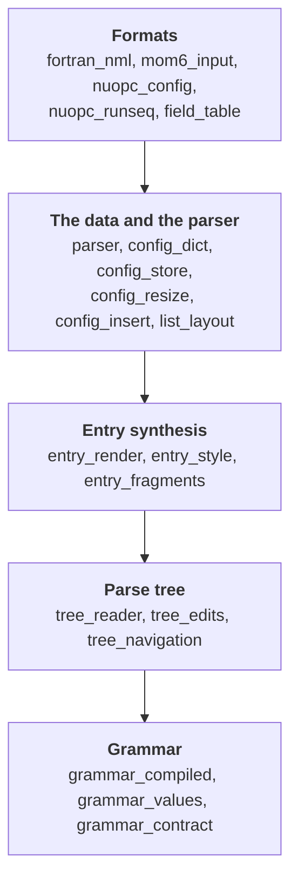
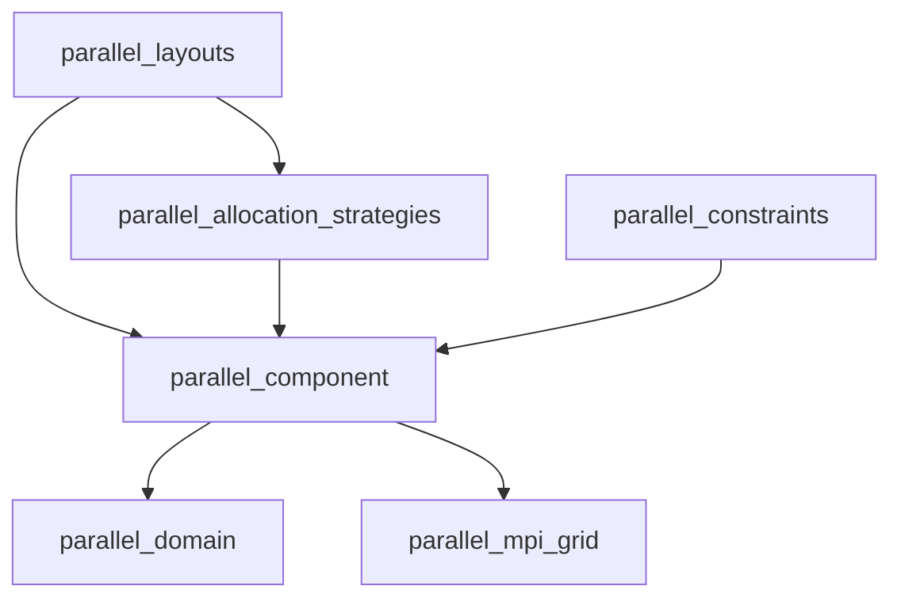

# Architecture

This guide is for developers who want to change the package or extend it: to a new configuration
format, a new constraint or a new way of allocating cores. It explains how the package is
organised and why. The reasoning behind each module is written once, in its docstring, and the
[Internals](../api/internals/grammar.md) pages of the API reference render those docstrings, so
this guide links to them rather than repeating them.
[`AGENTS.md`](https://github.com/ACCESS-NRI/access-config-utils/blob/main/AGENTS.md), at the root
of the repository, lists the invariants of the design in full, for coding agents and for anyone
who wants every rule in one place.

## Two independent halves

The package has two halves, and neither imports the other:

- the **configuration files**: parsers that read a configuration file into a dict and write it
  back out, with every byte the edits did not touch left as it was;
- the **parallel layouts**: the enumeration of the ways a number of cores can be shared among the
  components of a model.

The only runtime dependencies are [Lark](https://lark-parser.readthedocs.io/), which the parsers
are built on, and ruamel.yaml.

## The configuration files

Each format with a grammar is a subclass of `ConfigParser` that declares little more than the
grammar: everything else, from reading the parse tree to editing it, is shared. The shared code
falls into four groups, and imports run one way through them, from the formats down to the
grammar:

An arrow points from a group to one it imports from, and a group may also import from any group
further down. There is no cycle anywhere in the package, and no import made inside a function to
hide one.

| Group | Modules | What they do |
|---|---|---|
| [Grammar](../api/internals/grammar.md) | `grammar_contract`, `grammar_values`, `grammar_compiled`, and the shared `config.lark` | The rule names every grammar must use, the value types and how each maps to a Python value, and the compiled grammar |
| [Parse tree](../api/internals/parse-tree.md) | `tree_navigation`, `tree_edits`, `tree_reader` | Reading a Lark tree, changing one, and turning one into a reference per key |
| [Entry synthesis](../api/internals/entry-synthesis.md) | `entry_fragments`, `entry_style`, `entry_render` | The text of a key the file does not have yet |
| [The data and the parser](../api/internals/editing.md) | `list_layout`, `config_insert`, `config_resize`, `config_store`, `config_dict`, `parser` | Adding an entry, resizing a list, the tree behind a configuration, the dict a caller sees, and the parser base class |

Three boundaries in this structure are easy to erode, and are what keep it free of cycles:

- **`tree_navigation` reads a tree, and `tree_edits` changes one.** Deciding where a new entry
  goes is a question about the tree, so it is answered in `tree_navigation`, not by the code
  synthesising the entry.
- **The reader hands back references, never a `Config`.** `EntryReader` records one `EntryRef` per
  key: the entry's node, its value nodes and its block. Turning those into a `ConfigList` or a
  nested `Config` is `config_dict`'s job, since a reader that built the dict would import the
  layer above it.
- **`ConfigStore` owns the tree, and `Config` owns the dict.** The store holds the references and
  changes the nodes; the `Config` normalises keys, decides whether an assignment adds a key or
  changes one, and wraps what the store reports. Neither reaches into the other.

The YAML and JSON parsers import nothing from the package: they wrap libraries that already read
and write their formats, and keep the same `parse` and `str`.

[How parsing and editing work](parsers.md) follows a file through these modules, and
[Adding a parser](adding-a-parser.md) shows what a new format has to provide.

## The parallel layouts

| Module | What it holds |
|---|---|
| `parallel_domain` | `Domain`, the grid of points a component works on, and `DomainDecompositionSpec` |
| `parallel_mpi_grid` | `MPICartesianGrid`, a grid of MPI ranks, and the enumeration of grids for a number of ranks |
| `parallel_component` | `ParallelComponent`, the input tree; `ComponentLayout`, the result; `CoreSharing`; and the constraint base classes |
| `parallel_constraints` | The ready-made constraints |
| `parallel_allocation_strategies` | `AllocationStrategy`, `RootAllocation` and the four allocation modes, and the scheduling of a parent's cores among its sub-components |
| `parallel_layouts` | `iter_layouts` and the search |

The structure of a model and the way its cores are allocated are deliberately two separate trees:
a `ParallelComponent` tree says what the model is, and an `AllocationStrategy` tree what a study
asks of it, so one model serves many studies. The search in `parallel_layouts` knows none of the
allocation modes by name. Everything a mode means is on its own class, and the scheduling that has
to know every mode at once sits next to them, in `parallel_allocation_strategies`, so a new mode
is added without changing the search. [How the layout search works](layout-search.md) describes
the search and the protocol a mode implements.

## Task guides

The repository's [`skills/`](https://github.com/ACCESS-NRI/access-config-utils/tree/main/skills)
directory holds step-by-step guides for the recurring tasks, written for coding agents but
readable as they are: adding a parser, debugging a grammar, adding a constraint, and the checks to
run before committing. The pages of this guide cover the same tasks for people:

- [How parsing and editing work](parsers.md)
- [Adding a parser](adding-a-parser.md)
- [Debugging a grammar](debugging-grammars.md)
- [How the layout search works](layout-search.md)
- [Adding a constraint](adding-a-constraint.md)
- [Contributing](contributing.md): the development setup, the tests, the code style and the
  documentation.
