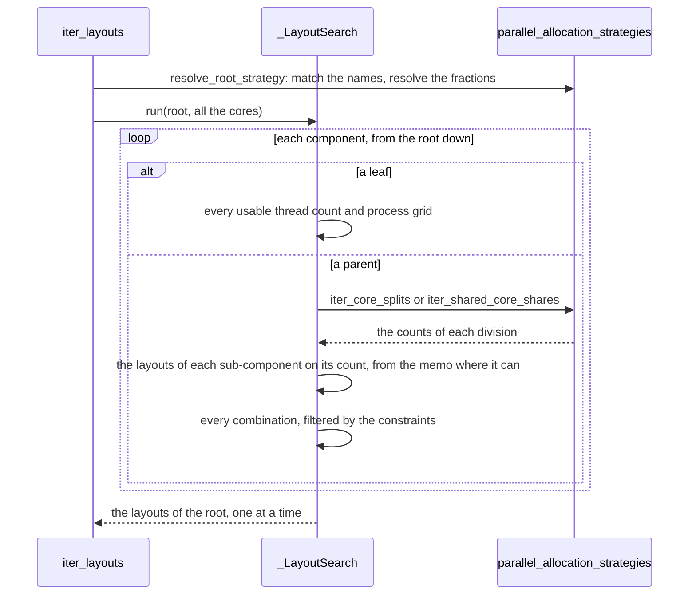

# How the layout search works

The search for parallelisation layouts asks one question at every component of the tree: *given this
component and this many cores, what are all its valid layouts?* Cores go down the tree, and layouts
come back up. Here we look at how that question is answered, at the protocol that the allocation
modes implement, and at how to change the search safely. The module docstrings of
[`parallel_layouts`](../api/layout-search.md) and
[`parallel_allocation_strategies`](../api/allocation-strategies.md) give the reasoning in full.

## The two trees

A search is given two trees of the same shape. The `ParallelComponent` tree says what the model is,
and the `AllocationStrategy` tree says how a study wants its cores allocated. They are kept apart so
that one model can be used for many studies, and they are matched by name. Before the search starts,
`resolve_root_strategy` checks that the strategy tree names exactly the sub-components of the
component tree at every level, because there is no default mode. It also turns every fraction of the
total into a number of cores, once, so that the search itself only ever sees counts.

## The recursion

One call of `iter_layouts` is one `_LayoutSearch`. It holds the two things that are fixed for the
whole search: the total number of cores, and a memo of the layouts of every sub-tree that has
already been worked out.

A **leaf** uses its cores itself. For each thread count in its range that divides its cores, it runs
`n_cores // threads_per_rank` ranks. For each grid of those ranks that its domain can be split over,
there is one candidate layout. A leaf with no domain has one candidate for each thread count. Each
candidate is checked against the local constraints of the leaf, both its own and those of its
strategy.

A **parent** hands its cores down. Its strategies give every way of dividing them among its
sub-components, through `iter_core_splits`. For a parent whose sub-components share its cores, they
give every combination of counts that fits, through `iter_shared_core_shares`. For each division,
the question is put to every sub-component with its share. Under a shared parent, a sub-component at
an offset other than 0 only keeps its layouts that run one rank on each core. Every combination of
one layout for each sub-component is then a candidate layout of the parent. It is checked against
the group constraints of the parent, and then against its local ones.

The large numbers come from that combining step: two sub-components with 30 layouts each already
give 900 combinations for one division. Two things keep it affordable:

- **Rejecting early.** A constraint is checked at its own component, so a layout that it rejects is
  dropped before anything is built on it. A division in which some sub-component has no layout is
  abandoned before its combinations are formed.
- **Asking once.** The layouts of a sub-tree only depend on the component, its cores, its thread
  range and its strategy, which together are the key of the memo. Every division that gives the
  atmosphere 40 cores asks about the atmosphere on 40 cores, and the answer is only worked out the
  first time. The total number of cores is not in the key, because it is fixed for the life of the
  memo. This is why a search is not reused across totals, and why the memo is never kept at module
  level.

Only the layouts of the whole tree are yielded one at a time. Below the root, the layouts of a
sub-tree are held as a tuple, because forming the combinations goes through each of them many times.
The memory that a search needs therefore grows with the answers of the sub-trees, and not with the
number of layouts.

## The allocation modes

The search never names an allocation mode. A mode is a subclass of `AllocationStrategy`, and what
it means is on its own class, behind a small protocol of `_`-prefixed members:

| Member | What it says |
|---|---|
| `_phase` | Where the mode is served among siblings that divide a parent's cores: fixed 0, weighted 1, free 2. It has no default, so a mode that forgets it fails on the first search, by name. |
| `_iter_core_shares(allocs, budget)` | Every way of sizing a group of siblings in this mode from the cores left to them. The cores reserved for the other modes are already taken out of the budget, so a mode never learns the others exist. |
| `_reserved_cores(allocs)` | How many cores the group needs at least, so that earlier phases leave them. 0 by default, which is always correct: it is a hint for pruning, not a rule. |
| `_describe_infeasible(allocs, names, budget)` | Why the group could not be served, for the log. `None` by default. |
| `_shared_core_range(parent_cores)` | The counts the mode offers under a shared parent, given the cores left of the range from the sub-component's offset. `None` by default, which means the mode cannot size such a sub-component. |

`iter_core_splits` is the one function that knows every mode at once. It groups the siblings by
mode, serves the groups in the order of their phases, and gives each group the budget that the
earlier ones left. It is a function of the sibling group, and not a method of one strategy, because
weighted siblings share one multiplier, which no single strategy can choose. It sits next to the
modes, in `parallel_allocation_strategies`. In this way `parallel_layouts` imports the module of the
modes, and never the other way round.

A shared parent does not use the phases at all, because nothing is divided.
`iter_shared_core_shares` asks each sub-component for its `_shared_core_range`, and yields the
combinations that cover the range. `WeightedAllocation` and `WholeRangeAllocation` are mirror images
of each other. A weight is a share of a divided budget, and means nothing under a shared parent. A
whole range is all of a shared range, and means nothing under a parent that divides its cores. Each
raises `ValueError` on the path that it does not take.

### Adding a mode

A new mode is a new class in `parallel_allocation_strategies`, deriving from `AllocationStrategy`,
which:

1. declares its `_phase`;
2. implements `_iter_core_shares`;
3. overrides `_shared_core_range` if it can size a sub-component of a shared parent, and
   `_reserved_cores` and `_describe_infeasible` if it can help the pruning or the diagnostics;
4. validates its fields in `__post_init__`, as a frozen dataclass, raising `ValueError` naming the
   class and the field.

Nothing changes in `iter_core_splits` or in `parallel_layouts`. If a change seems to need
`isinstance(strategy, SomeMode)` in `parallel_layouts`, or to read the fields of a mode there, such
as `min_cores` or `weight`, the logic belongs on the mode.

## Rules the search relies on

- Every public type is a frozen dataclass that validates its arguments in `__post_init__`. It is
  also hashable, because components, strategies and constraints are part of the key of the memo. The
  `subcomponents` mapping of a strategy is left out of its hash and kept in its equality, which is
  what tells apart strategies that hash alike.
- Cores are what is divided, everywhere. A rank costs as many cores as it runs threads, so ranks are
  never divided.
- A constraint returns `False` for a layout that it rejects, and raises `ValueError` for one that it
  cannot evaluate, such as a domain rule on a component with no domain. Answering `False` there
  would quietly empty the search.
- `iter_layouts` validates its arguments when it is called, and returns a lazy iterator. It is not a
  generator function, so that a mistake raises at the call and not at the first `next()`.
- Each module logs under its own name, `access.config.parallel_layouts` and
  `access.config.parallel_allocation_strategies`, at `DEBUG` level, for every dead end.

## Testing a change to the search

The tests pin the order of the layouts and the text of the log messages and of the errors, but there
are no golden outputs of whole searches. To show that a change to the search keeps its behaviour,
compare whole enumerations. Import the module as it is, and a patched copy of it. Run both over a
range of trees, from a single leaf to nested, threaded, constrained and shared ones, and also over a
budget that is too small for them. Then check that the two yield the same layouts in the same order,
log the same messages and raise the same errors.
