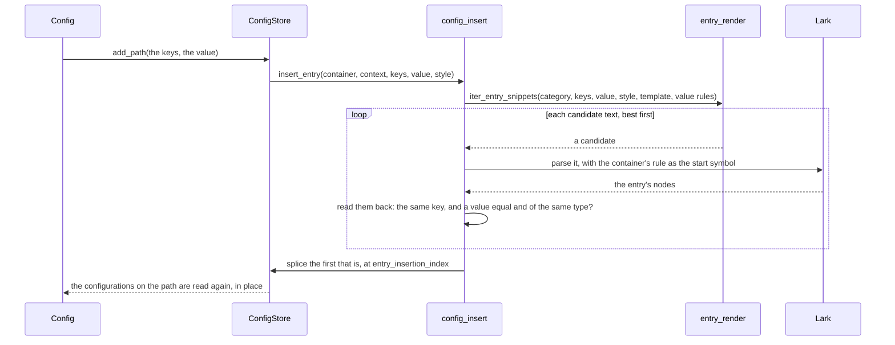

# How parsing and editing work

The parsers built on a grammar share one requirement, which shapes everything they do: a round
trip is exact. `str(parser.parse(text)) == text`, byte for byte, comments and whitespace included,
and an edit changes the text only where the edit says. So the parse tree is the configuration:
every edit is made to the tree, and the text is written back from the tree by Lark's
`Reconstructor`. The dict a caller sees is a view kept in step with it.

This page follows a configuration through its life: parsed, read, edited, extended and written
out. The module docstrings, rendered in the [Internals](../api/internals/grammar.md) pages of the
reference, give the reasoning behind each step.

## Parsing

`ConfigParser.parse` does four things:

1. It compiles the parser's grammar with `compile_grammar`, which builds the `Lark` parser, the
   `Reconstructor` that writes a tree back out, and `GrammarInfo`, an index of the grammar's rules.
   Compiling costs far more than parsing, so the result is cached on the grammar text, and parsers
   sharing a grammar share it. A `ParseContext` pairs it with what the parser class declares: how
   keys are cased, the templates of new entries, the block rules and what a repeated block means.
2. It parses the text with a newline added, so that no grammar has to handle a last line without
   one, and names the start symbol, `start`, since a grammar has several.
3. It annotates every node of the tree with its parent (`AddParent`), since Lark gives no way of
   walking up a tree.
4. It wraps the tree in a `ConfigStore` and the store in a `Config`.

## Reading the tree

The rule names of a grammar are an API: the reader is a Lark `Interpreter`, which calls a method
named after each rule, so an entry is found only where the grammar names it `key_value`,
`key_list`, `key_block` or `key_null`, usually by aliasing a rule of its own with `->`. Its key is
the first token of a rule named `key`, and its values are the nodes of the *value-type rules*
registered in `VALUE_TYPE_HANDLER_REGISTRY`, such as `integer`, `string` or `logical`, each with a
single token. [`grammar_contract`](../api/internals/grammar.md#access.config.grammar_contract)
states the contract in full.

`EntryReader` walks a container node, the start rule or a block, and records an `EntryRef` for
each key below it: the entry's category, the nodes of the entries writing it, the nodes holding
its values, and the block node of a block. It stops at that. Turning a reference into a value is
`entry_value`, and wrapping a list into a `ConfigList` or a block into a nested `Config` is done
by `config_dict`, so that the tree modules never import the layer holding the dict.

A `ConfigStore` holds the references of one container, `refs`, and a block gets a store of its
own, made by `child`. The `Config` holding it is a `dict` whose items are read from those
references once, and updated as the store reports changes.

## Changing a value

Assigning to a key the configuration has normalises the key, as the format cases them, and asks
the store to `replace` its value. The store writes the new value into the token of the value
node, through the handler of the node's rule: the handler checks the type, exactly, and writes the
value in the notation of the token it replaces, its quotes, its spelling of a logical, its exponent
letter. Nothing else in the tree changes, so nothing else in the text does.

A list of the same length is written the same way, an element at a time. A list of another length
is laid out afresh around the elements that stay: `config_resize` asks `list_layout` for the
candidate texts of the new list, given which old position each new element stands for, and keeps
the first that parses back as the list requested. Every value is checked before any node changes,
so a write that fails changes nothing.

## Adding a key

A new key is never built as tree nodes by hand, since that would mean reproducing what Lark does
with rule inlining, aliases, filtered terminals and imported names. Its *text* is written instead,
and Lark parses it:

The candidates come from `entry_render`, in this order:

1. a copy of the nearest entry of the same kind above the insertion point, found by
   `probe_entry_style` and turned into a template by `donor_template`, with its spacing and
   punctuation and, where the new value is written with the same rule, its notation;
2. the template the parser declares in `entry_templates`, indented like the entry above;
3. the same template, with its own indentation.

Each is written once for every value-type rule of the format that accepts the value, in the order
of `VALUE_TYPE_HANDLER_REGISTRY`. That order is style, never correctness: every candidate is
parsed and read back, and one is accepted only if it yields exactly the key and a value equal to,
and of the same type as, the one asked for. Without that check, `Path("foo")` could be written as
the bare word `foo`, which a format with an `identifier` rule reads back as a `str`. Nothing is
spliced until a candidate passes, and when none does, `UnsupportedEntryError` names the value types
the format writes.

The new entry goes where `entry_insertion_index` says: one past the last entry of the container,
then over any comment lines that start there, up to a blank line, the next entry or the end. A
comment at the end of an entry's line belongs to that entry, so a new entry never lands inside one.
The new nodes are annotated with their parents on their own before they are spliced in, and the
configurations on the key's path are then read again, in place, so that a reference a caller holds
sees the new key.

### Chains and blocks

Some blocks have no body of their own: a Fortran derived type is written one component per line,
`a%b = 1`, and a field table's header is three keys on one line. `entry_chain` follows such
entries, and a template's `{keys:SEP}` marker writes every key of the path parted by `SEP`, so the
Fortran template `{keys:%} = {value}` writes a component of any depth. A key added to such a block
is written by the nearest configuration whose block has a body, as a line carrying the whole key
path, and a dict the format cannot write as a block goes one level deeper. A block created by an
assignment has no entries to copy, so it takes the style of the nearest sibling block above it
(`probe_sibling_block_style`).

## Deleting a key

Deleting a key unlinks the entries writing it. Removing an entry can leave a tree the grammar
could not have produced, which the reconstructor then refuses to write, so `tree_edits` repairs it
in two ways: `prune_empty_wrappers` drops a wrapper that required the entry, such as a line rule
left without its assignment, and `merge_adjacent_repetitions` joins two runs of text that may not
be adjacent, as between Fortran's namelist groups. The configurations above are then read again,
from the nearest one whose container survived.

## Writing the text

`str` reconstructs the text from a copy of the tree, since the reconstructor changes the tree it
writes, and strips the newline `parse` added. A configuration left with no entries still writes
out its comments and blank lines; only a grammar that cannot derive a container without entries
writes the empty string.

The reconstructor picks the rule it writes a node with by matching the node's children, and Lark
drops anonymous punctuation such as `"="` from the tree before it looks. So two rules aliased to
the same category have to differ in their children, not only in their punctuation: NUOPC's
top-level `key: value` and its table's `key = value` were once indistinguishable, and a table
entry could be written back in the top-level syntax. The punctuation that tells two syntaxes apart
is kept in a rule of its own, `assign: "="` in `nuopc_config`.

## The YAML and JSON parsers

None of this applies to `YAMLParser` and `JSONParser`, which wrap ruamel.yaml and `json`. Their
configurations are the libraries' own data, and their `str` writes the data out again, in the
style read off the text it came from.
