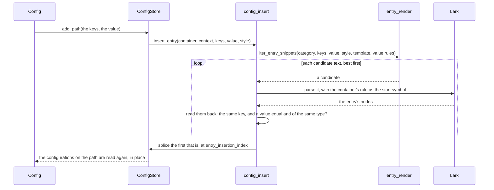

# How parsing and editing work

The parsers that are built on a grammar share one requirement, which shapes everything they do: a
round trip is exact. `str(parser.parse(text)) == text` holds byte for byte, comments and whitespace
included, and an edit changes the text only where the edit says. For this reason, the parse tree is
the configuration. Every edit is made to the tree, and the text is written back from the tree by
Lark's `Reconstructor`. The dict that a caller sees is a view, which is kept in step with the tree.

Here we follow a configuration through its life: it is parsed, read, edited, extended and written
out. The module docstrings, which are shown in the [Internals](../api/internals/grammar.md) pages of
the reference, give the reasoning behind each step.

## Parsing

`ConfigParser.parse` does four things:

1. It compiles the grammar of the parser with `compile_grammar`. This builds the `Lark` parser, the
   `Reconstructor` that writes a tree back out, and `GrammarInfo`, which is an index of the rules of
   the grammar. Compiling costs far more than parsing, so the result is cached on the grammar text,
   and parsers with the same grammar share it. A `ParseContext` pairs the result with what the
   parser class declares: how keys are cased, the templates of new entries, the block rules and what
   a repeated block means.
2. It parses the text with a newline added, so that no grammar has to handle a last line without
   one. It names the start symbol, `start`, because a grammar has several.
3. It annotates every node of the tree with its parent (`AddParent`), because Lark gives no way of
   walking up a tree.
4. It wraps the tree in a `ConfigStore` and the store in a `Config`.

## Reading the tree

The rule names of a grammar are an API. The reader is a Lark `Interpreter`, which calls a method
named after each rule. An entry is therefore only found where the grammar names it `key_value`,
`key_list`, `key_block` or `key_null`, which it usually does by aliasing a rule of its own with
`->`. The key of an entry is the first token of a rule named `key`. Its values are the nodes of the
*value-type rules* registered in `VALUE_TYPE_HANDLER_REGISTRY`, such as `integer`, `string` or
`logical`, each with a single token.
[`grammar_contract`](../api/internals/grammar.md#access.config.grammar_contract) states the contract
in full.

`EntryReader` walks a container node, which is the start rule or a block. It records an `EntryRef`
for each key below it: the category of the entry, the nodes of the entries that write it, the nodes
that hold its values, and the block node of a block. It stops there. `entry_value` turns a reference
into a value. `config_dict` wraps a list into a `ConfigList`, or a block into a nested `Config`. In
this way the tree modules never import the layer that holds the dict.

A `ConfigStore` holds the references of one container, in `refs`. A block gets a store of its own,
made by `child`. The `Config` that holds the store is a `dict` whose items are read from those
references once, and updated as the store reports changes.

## Changing a value

An assignment to a key that the configuration has first normalises the key, as the format cases its
keys. It then asks the store to `replace` the value. The store writes the new value into the token
of the value node, through the handler of the rule of that node. The handler checks the type,
exactly, and writes the value in the notation of the token it replaces: its quotes, its spelling of
a logical, its exponent letter. Nothing else in the tree changes, so nothing else in the text does.

A list of the same length is written in the same way, one element at a time. A list of another
length is written afresh around the elements that stay. `config_resize` first checks that a new
element has the type of the old ones, when they all have the same type. It then asks `list_layout`
for the candidate texts of the new list, given which old position each new element stands for, and
keeps the first candidate that parses back as the list requested. Every value is checked before any
node changes, so a write that fails changes nothing.

## Adding a key

A new key is never built as tree nodes by hand, because this would mean reproducing what Lark does
with rule inlining, aliases, filtered terminals and imported names. Instead, its *text* is written,
and Lark parses it:

The candidates come from `entry_render`, in this order:

1. a copy of the nearest entry of the same kind above the insertion point. `probe_entry_style` finds
   this entry and `donor_template` turns it into a template. The copy has its spacing and
   punctuation and, where the new value is written with the same rule, its notation;
2. the template that the parser declares in `entry_templates`, with the indentation of the entry
   above;
3. the same template, with its own indentation.

Each candidate is written once for every value-type rule of the format that accepts the value, in
the order of `VALUE_TYPE_HANDLER_REGISTRY`. That order is a matter of style, never of correctness.
Every candidate is parsed and read back. It is only accepted if it gives exactly the key, and a
value that is equal to the one asked for and of the same type. Without this check, `Path("foo")`
could be written as the bare word `foo`, which a format with an `identifier` rule reads back as a
`str`. Nothing is spliced until a candidate passes. When none does, `UnsupportedEntryError` names
the value types that the format writes.

The new entry goes where `entry_insertion_index` says. This is one past the last entry of the
container, and then past any comment lines that start there, up to a blank line, the next entry or
the end. A comment at the end of the line of an entry belongs to that entry, so a new entry never
lands inside one. The new nodes are annotated with their parents on their own, before they are
spliced in. The configurations on the path of the key are then read again, in place, so that a
reference held by a caller sees the new key.

### Chains and blocks

Some blocks have no body of their own. A Fortran derived type is written with one component on each
line, as in `a%b = 1`, and the header of a field table is three keys on one line. `entry_chain`
follows such entries. The `{keys:SEP}` marker of a template writes every key of the path, separated
by `SEP`, so the Fortran template `{keys:%} = {value}` writes a component of any depth. A key that
is added to such a block is written by the nearest configuration whose block has a body, as a line
that carries the whole key path. A dict that the format cannot write as a block goes one level
deeper. A block created by an assignment has no entries to copy, so it takes the style of the
nearest sibling block above it (`probe_sibling_block_style`).

## Deleting a key

Deleting a key unlinks the entries that write it. Removing an entry can leave a tree that the
grammar could not have produced, and the reconstructor refuses to write such a tree. `tree_edits`
therefore repairs the tree in two ways. `prune_empty_wrappers` drops a wrapper that required the
entry, such as a line rule left without its assignment. `merge_adjacent_repetitions` joins two runs
of text that may not be adjacent, as between the namelist groups of Fortran. The configurations
above are then read again, from the nearest one whose container survived.

## Writing the text

`str` reconstructs the text from a copy of the tree, because the reconstructor changes the tree that
it writes. It also strips the newline that `parse` added. A configuration left with no entries still
writes out its comments and blank lines. Only a grammar that cannot derive a container without
entries writes the empty string.

The reconstructor picks the rule that it writes a node with by matching the children of the node.
Lark drops anonymous punctuation such as `"="` from the tree before the reconstructor looks. Two
rules aliased to the same category therefore have to differ in their children, and not only in their
punctuation. For example, the top-level `key: value` of NUOPC and the `key = value` of its tables
were once indistinguishable, and a table entry could be written back in the top-level syntax. The
punctuation that tells two syntaxes apart is kept in a rule of its own, which is `assign: "="` in
`nuopc_config`.

## The YAML and JSON parsers

None of this applies to `YAMLParser` and `JSONParser`, which wrap ruamel.yaml and `json`. Their
configurations are the data of those libraries. Their `str` writes the data out again, in the style
detected from the text it came from.
