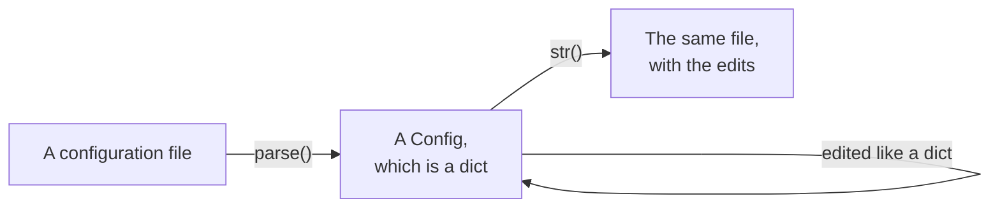
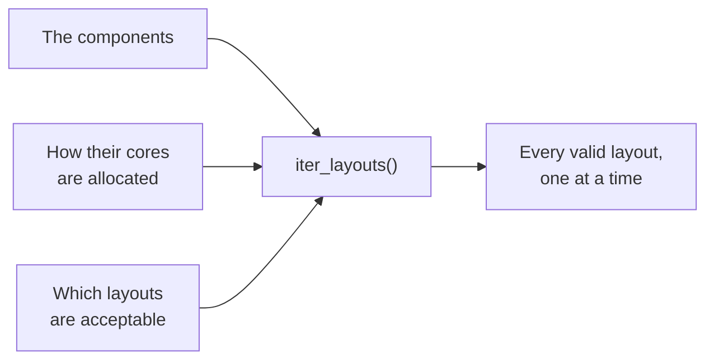

# access-config-utils

access-config-utils is a Python package for working with the configurations of the climate models
developed at [ACCESS-NRI](https://github.com/ACCESS-NRI). It has two parts, which you can use
independently of each other.

**Configuration files.** A parser reads a configuration file of a model into a Python dict. You
can then edit it like any other dict, and write it back out. Only what you edit changes.
Everything else is written back exactly as it was, including the comments, the blank lines, the
spacing and the way each value is written.

**Parallelisation layouts.** A parallelisation layout says how the cores of a job are shared
among the components of a model: how many MPI ranks and OpenMP threads each component runs, and
how its ranks are arranged in a process grid. The layout search finds every layout that the model
can run and that your study asks for.

## Configuration files

| Format | Files | Parser |
|---|---|---|
| [Fortran namelists](user-guide/formats/fortran-namelists.md) | `input.nml`, `ice_in`, `*.nml` | `FortranNMLParser` |
| [MOM6 parameter files](user-guide/formats/mom6.md) | `MOM_input` | `MOM6InputParser` |
| [NUOPC run configurations](user-guide/formats/nuopc-runconfig.md) | `nuopc.runconfig` | `NUOPCParser` |
| [NUOPC run sequences](user-guide/formats/nuopc-runseq.md) | `nuopc.runseq` | `NUOPCRunSeqParser` |
| [FMS field tables](user-guide/formats/field-tables.md) | `field_table`, in the legacy format | `FieldTableParser` |
| [YAML](user-guide/formats/yaml-json.md) | Payu's `config.yaml`, and any other YAML file | `YAMLParser` |
| [JSON](user-guide/formats/yaml-json.md#json) | `forcing.json`, and any other JSON file | `JSONParser` |

Every parser has a `parse` method, which takes the text of a file and returns the configuration
it holds. The values are read as Python values: numbers, strings, booleans, `None` and lists. A
block of entries, such as a namelist group, is read as a nested dict. When you change a value,
only that value is rewritten. When you add a key, it is written in the same way as the entries
around it. A list can grow and shrink like a Python list, and the elements that stay keep their
text.

## Parallelisation layouts

A model is described as a tree of components. The parents divide their cores among their
sub-components, or let them share the same cores. The leaves do the work, each on a domain that
can be split over a grid of MPI ranks. A search needs the tree and a number of cores. You can
also tell it:

- how the cores are to be allocated: an exact count for a component, a fraction of the total, a
  ratio between siblings, or any count within bounds;
- the constraints a layout has to satisfy: the shape of a process grid, the size of the
  subdomains, the number of threads, how many cores may be left idle.

The search then gives you every layout that satisfies them, one at a time, because there can be
millions of them. [access-profiling](https://github.com/ACCESS-NRI/access-profiling) uses it to
generate the experiments of profiling and scaling studies of the ACCESS models.

## Where to go next

- If you are new to the package, start with [Getting started](getting-started.md). It installs
  the package, edits a namelist and runs a first layout search.
- The [User guide](user-guide/index.md) explains how to read, edit and write each format, and how
  to describe a model and search for its layouts.
- The [Developer guide](developer-guide/index.md) explains how the package is organised, how to
  add a parser or a constraint, and how to contribute.
- The [API reference](api/index.md) documents every class and function.

## Getting help

To get help, ask on the [ACCESS Hive Forum](https://forum.access-hive.org.au/), or open an issue
on [GitHub](https://github.com/ACCESS-NRI/access-config-utils/issues).
