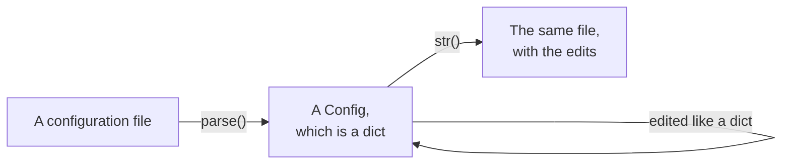
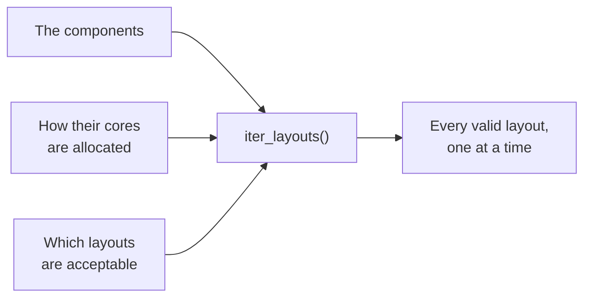

# access-config-utils

access-config-utils is a Python package for working with the configurations of the climate models
developed at [ACCESS-NRI](https://github.com/ACCESS-NRI). It has two independent parts.

**Configuration files.** Parsers read the files the models are configured with into Python dicts,
which are edited like any other dict and written back out. Everything an edit does not touch is
written back exactly as it was: comments, blank lines, spacing and the spelling of every value.

**Parallel layouts.** A layout search finds every way a number of cores can be shared among the
components of a model, as MPI ranks, OpenMP threads and process grids, that the model can run and
that a study asks for.

## Configuration files

| Format | Files | Parser |
|---|---|---|
| [Fortran namelists](user-guide/formats/fortran-namelists.md) | `input.nml`, `ice_in`, `*.nml` | `FortranNMLParser` |
| [MOM6 parameter files](user-guide/formats/mom6.md) | `MOM_input` | `MOM6InputParser` |
| [NUOPC run configurations](user-guide/formats/nuopc-runconfig.md) | `nuopc.runconfig` | `NUOPCParser` |
| [NUOPC run sequences](user-guide/formats/nuopc-runseq.md) | `nuopc.runseq` | `NUOPCRunSeqParser` |
| [FMS field tables](user-guide/formats/field-tables.md) | `field_table`, in the legacy format | `FieldTableParser` |
| [YAML](user-guide/formats/yaml-json.md) | Payu's `config.yaml`, and any other YAML file | `YAMLParser` |
| [JSON](user-guide/formats/yaml-json.md#json) | `forcing.json`, and any other JSON file | `JSONParser` |

Every parser has a `parse` method that takes the text of a file and returns the configuration it
holds. Values are read as Python values: numbers, strings, booleans, `None` and lists, with a
nested dict for a block of entries such as a namelist group. Editing a value rewrites that value
alone. Adding a key writes it the way the entries around it are written, and a list can grow and
shrink like a Python list, with the elements that stay keeping their text.

## Parallel layouts

A model is described as a tree of components: the parents divide their cores among their
sub-components, or let them share them, and the leaves run the work, each on a domain that can be
split over a grid of MPI ranks. A search is given the tree, a number of cores and, optionally:

- how the cores are to be allocated: an exact count for a component, a fraction of the total, a
  ratio between siblings, or any count within bounds;
- the constraints a layout has to satisfy: the shape of a process grid, the size of the
  subdomains, the number of threads, how many cores may be left idle.

It yields every layout that satisfies them, one at a time, since there can be millions.
[access-profiling](https://github.com/ACCESS-NRI/access-profiling) uses it to generate the
experiments of profiling and scaling studies of the ACCESS models.

## Where to go next

- [Getting started](getting-started.md) installs the package, edits a namelist and runs a first
  layout search.
- The [User guide](user-guide/index.md) explains how to read, edit and write each format, and how
  to describe a model and search its layouts.
- The [Developer guide](developer-guide/index.md) explains how the package is organised, how to
  add a parser or a constraint, and how to contribute.
- The [API reference](api/index.md) documents every class and function.

## Getting help

Ask on the [ACCESS Hive Forum](https://forum.access-hive.org.au/), or open an issue on
[GitHub](https://github.com/ACCESS-NRI/access-config-utils/issues).
